# Secure Cloud Data Deduplication with Efficient Re-encryption

A Java-based web application exploring cloud file management, data deduplication, secure file access, and re-encryption concepts.

## 📌 Project Overview

This project demonstrates a web-based approach to managing files in a cloud-storage environment. It uses Java application components, JSP pages, database connectivity, and encryption-related utilities.

The application includes workflows for users, cloud providers, and auditors. It is intended for educational purposes and further development in secure cloud storage.

## ✨ Features

- **User and Account Management:** Registration, login, and account-related workflows.
- **Cloud File Management:** File upload, download, and management pages.
- **Encryption and Key Handling:** Encryption/decryption utilities and re-encryption-related concepts.
- **Auditing and Administration:** Auditor interfaces, file requests, and approval-related workflows.

*Feature descriptions should be verified against the running application. This project has not been presented as production-ready.*

## 🛠️ Technologies Used

- **Language:** Java
- **Web interface:** JavaServer Pages (JSP), HTML, CSS
- **Build tool:** Apache Ant
- **IDE configuration:** NetBeans
- **Database:** MySQL
- **Application server:** Apache Tomcat
- **Version control:** Git and GitHub

## 🏗️ System Architecture

```text
             Web Browser
            JSP / HTML Pages
                   |
                   v
             Java Web Layer
       Login / File Operations
      Administration / Auditing
                   |
             +-----+-----+
             |           |
             v           v
      Encryption and   MySQL Database
      Key Utilities    Persistence
```

*Conceptual overview. Confirm the exact component interactions in the source code.*

## 📁 Project Structure

```text
Secure-Cloud-Data-Deduplication/
├── src/
│   └── java/              # Java source files
├── web/
│   ├── WEB-INF/
│   │   └── web.xml        # Web application configuration
│   ├── META-INF/
│   │   └── context.xml    # Context configuration
│   └── *.jsp              # JSP pages
├── nbproject/             # NetBeans project configuration
├── build.xml              # Apache Ant build file
├── .gitignore
├── screenshots/
└── README.md
```

## 🚀 Getting Started

### Prerequisites

- Java JDK compatible with the project; Java 8 was used for validation.
- Apache Ant
- Compatible Apache Tomcat installation
- MySQL Server
- MySQL JDBC driver

### 1. Clone the repository

```powershell
git clone https://github.com/SaikamHari/secure-cloud-data-deduplication.git
cd secure-cloud-data-deduplication
```

### 2. Configure the database

1. Start MySQL.
2. Identify the database name, tables, and required data from the source code or database setup.
3. Create the required database and tables.
4. Configure the database connection locally.
5. Ensure the MySQL JDBC driver is available to the application.

The exact schema and initialization steps must be confirmed from the project files.

### 3. Configure credentials

Review the database connection, encryption-key utilities, mail configuration, and `web/META-INF/context.xml`.

Use environment variables or local configuration for credentials where supported. Never commit real passwords, private keys, or API credentials.

### 4. Build the application

From the project root, run:

```powershell
ant compile
```

If the build fails, check the Java version, Ant configuration, dependencies, and whether any required files are locked.

### 5. Deploy to Tomcat

Use the deployment target configured in `build.xml`, or configure deployment through NetBeans.

Start Tomcat and open the configured application URL. The exact deployment target and URL should be confirmed from the project configuration.

## 📸 Application Screenshots

The following screenshots are included in the repository.

### Home Page

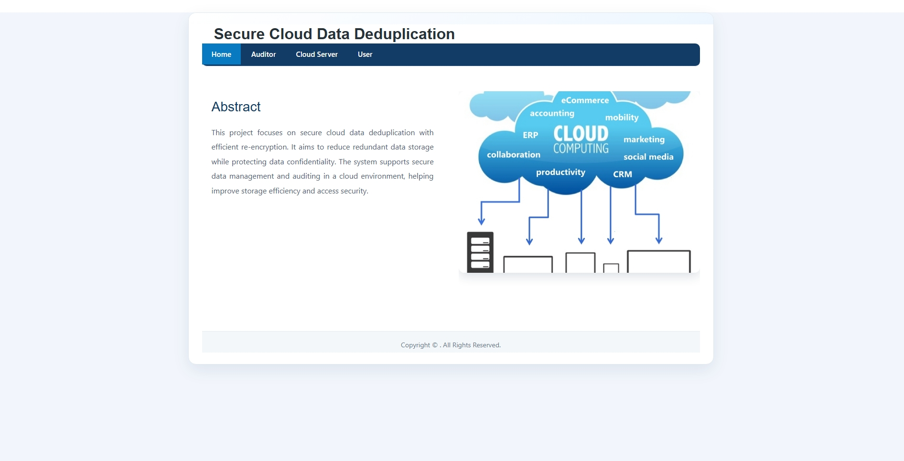

### User Interface

| Login | Registration |
|---|---|
| 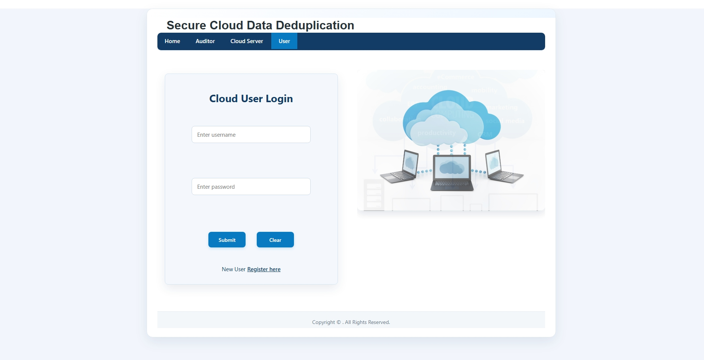 | 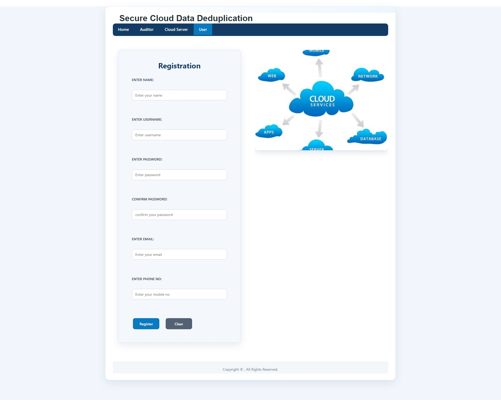 |

### Cloud Provider Interface

| Login | Home |
|---|---|
| 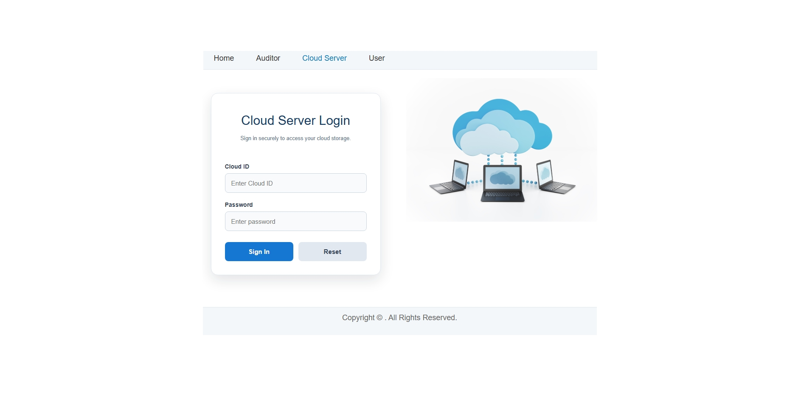 | 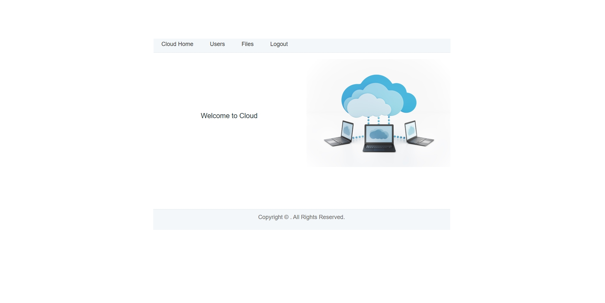 |

| Files | User Management |
|---|---|
| 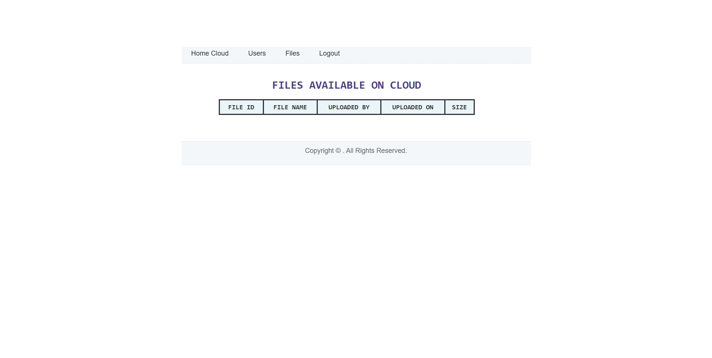 | 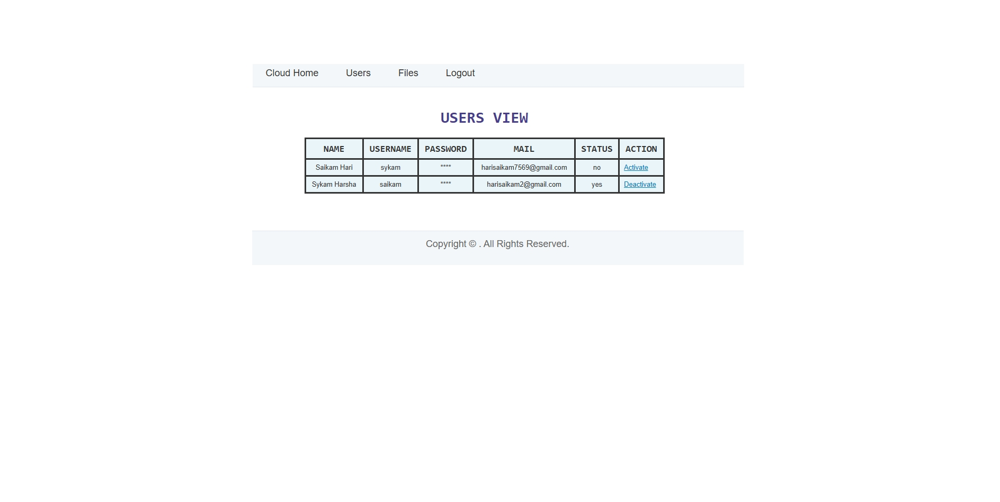 |

### Auditor Interface

| Login | Home |
|---|---|
| 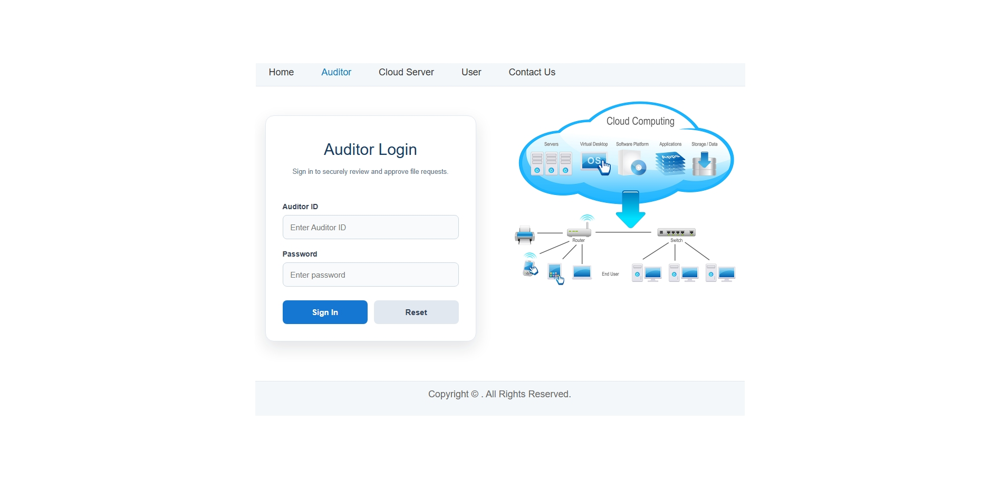 | 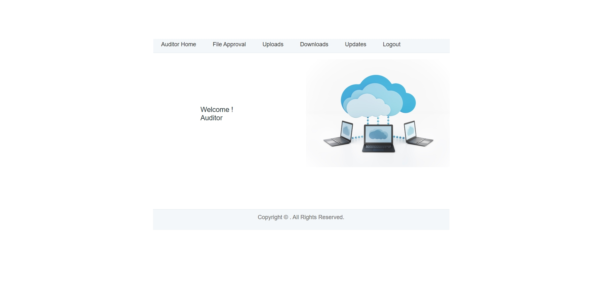 |

| Uploads | Downloads |
|---|---|
| 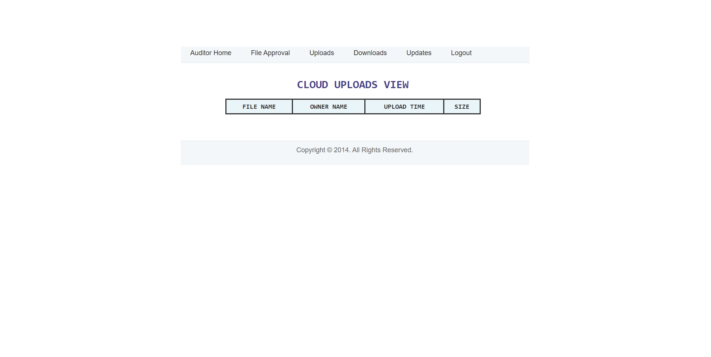 | 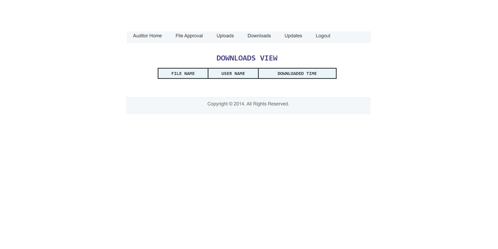 |

### File Approval

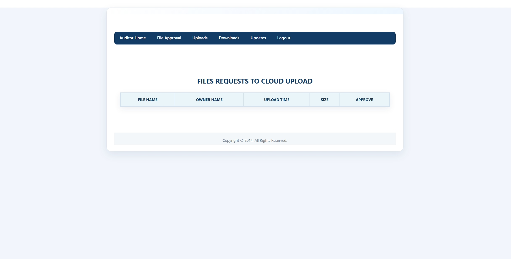

## 🔒 Security Considerations

- Keep database credentials outside tracked source files.
- Never commit email passwords, API tokens, or private encryption keys.
- Use synthetic test accounts and files for demonstrations.
- Review encryption algorithms and key-management logic before handling real data.
- Check the repository history for previously committed secrets.
- Use secure transfer protocols instead of plain FTP where file transfer is involved.
- Treat the project as educational unless it has undergone an appropriate security review.

## 🧪 Testing and Validation

- [ ] Confirm the project builds successfully.
- [ ] Verify that the application starts in the intended Tomcat environment.
- [ ] Test database connectivity.
- [ ] Test login and file workflows with test data.
- [ ] Test encryption and decryption workflows.
- [ ] Review error handling.
- [ ] Confirm credentials and private configuration are excluded from Git.

## 🎯 Future Improvements

- Externalize credentials and encryption keys.
- Document database schema creation and sample data.
- Add automated tests for file operations and encryption workflows.
- Improve input validation and error handling.
- Document reproducible build and deployment steps.
- Review cryptographic choices and key management.

## 👨‍💻 Developer

**Saikam Hari**  
Java Development | Secure Cloud-Storage Concepts

- GitHub: https://github.com/SaikamHari
- LinkedIn: https://www.linkedin.com/in/hari-saikam/

## 📄 License

No license has been selected for this repository yet. Add an appropriate license before granting others permission to reuse or distribute the code.
